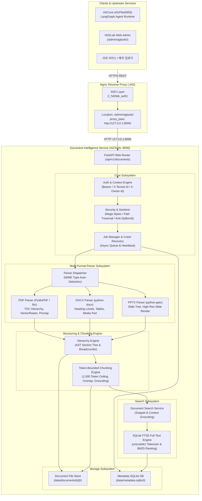
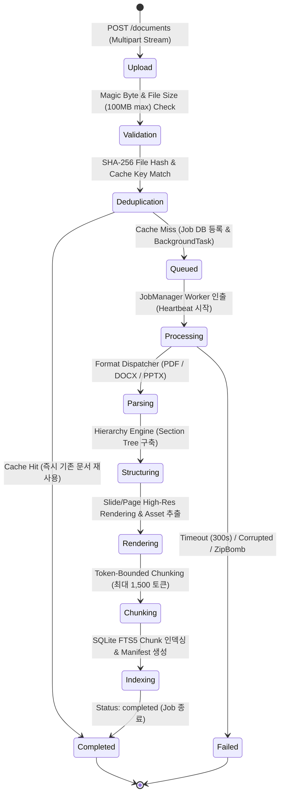

# HD2Lab Document Intelligence Service (AGPilot0006) — 시스템 아키텍처 및 설계 (ARCHITECTURE)

> **버전**: v2.0.0  
> **기준 일자**: 2026-11-13  
> **서비스 코드**: `06 / SERVE · DOCUMENT INTELLIGENCE SERVICE (AGTools)`  
> **연동 시스템**: AGCore (AGPilot0005), HD2Lab AI Gateway v3, Nginx Admin Proxy

---

## 1. 개요 및 설계 철학 (Overview & Architectural Philosophy)

**HD2Lab Document Intelligence Service (AGPilot0006 / AGTools)**는 사내에 축적된 비정형 문서(PDF, DOCX, PPTX)를 파싱하여 **계층적 문서 트리(Hierarchy Tree), 고해상도 시각 에셋(Images/Slides), 그리고 토큰 예산이 보장된 청크(Chunk)**로 구조화하고, LLM 에이전트(AGPilot0005)가 온디맨드로 조회할 수 있도록 서빙하는 독립 백엔드 서비스입니다.

### 1.1 핵심 설계 원칙
1. **독립 마이크로서비스 원칙 (Decoupled & Standalone)**:
   - 특정 LLM 프레임워크(LangGraph, LlamaIndex 등)에 종속되지 않고 순수한 HTTP REST API로만 동작합니다.
   - 대화 세션 관리 및 에이전트 의사결정은 **AGPilot0005(AGCore)**가 담당하고, 문서 파싱·구조화·에셋 추출·FTS 검색은 **AGPilot0006**이 전담합니다.
2. **LLM-Free Baseline 보장**:
   - 문서 파싱, 목차 구성, 슬라이드/페이지 렌더링, 청킹, 전문 검색(FTS5)은 외부 LLM API 비용이나 네트워크 종속 없이 100% 로컬 라이브러리 및 SQLite FTS5 엔진으로 완결됩니다.
3. **정보 무결성 및 시각 구성 이중 보존 (Visual & Structural Integrity)**:
   - 문서를 단순히 평문(Flat text)이나 축약된 Markdown으로 단순 변환하지 않습니다.
   - **위계 구조 보존**: Chapter $\to$ Section $\to$ Subsection $\to$ Paragraph / Table / Figure
   - **시각 정보 이중 보존**:
     - 원본 삽입 이미지 (Embedded Image)
     - 페이지/슬라이드 전체 고해상도 렌더링 (Page/Slide Full Render, 특히 PPTX는 레이아웃 자체가 정보이므로 필수)
   - **근거 연결 (Grounding)**: 본문 단락과 Figure/Table의 상호 ID 링크 및 원본 페이지/슬라이드 위치를 영구 보존합니다.

---

## 2. 전체 시스템 아키텍처 다이어그램 (System Architecture)



---

## 3. 데이터 파이프라인 및 작업 생명주기 (Job Lifecycle)

문서 업로드부터 파싱, 구조화, 인덱싱까지의 전체 파이프라인은 완전 비동기(Asynchronous Background Task)로 실행됩니다.



### 3.1 크래시 복구 메커니즘 (Crash Recovery on Startup)
- 서버 불시 재부팅, Uvicorn 프로세스 재시작 시 `lifespan` 초기화 루틴에서 `JobManager.recover_on_startup()`이 자동 호출됩니다.
- 상태가 `processing` 또는 `queued`로 멈춰 있는 고아 작업(Orphaned Jobs)을 감지하여 재시도 횟수(`retry_count`)를 점검하고, 한도 초과 시 `failed` 상태로 격리하여 큐 정체를 방지합니다.

### 3.2 캐시 기반 중복 제거 (Content Deduplication)
- 업로드된 파일의 SHA-256 해시값과 테넌트/파서 버전을 결합한 `cache_key`를 계산합니다.
- 동일 파일이 이미 정상 파싱 완료된 경우, 중복 파싱 연산 없이 기존 파싱 결과(`document_id`)를 1ms 내에 즉시 반환합니다.

---

## 4. 멀티 포맷 파서 엔진 아키텍처 (Multi-Format Parser Subsystem)

AGPilot0006은 문서 형식별 특성에 최적화된 독립 파서 모듈을 갖추고 있습니다.

### 4.1 PDF Parser (`app/parsers/pdf_parser.py`)
- **기반 라이브러리**: PyMuPDF (`fitz`)
- **TOC/Bookmark 계층 추출**: PDF 내부의 Outlines/Bookmarks 트리를 재귀 탐색하여 Level별 섹션 위계(`sec-1`, `sec-1-1`)를 자동 구축합니다. 북마크가 없는 비구조화 PDF의 경우 폰트 크기 및 Y축 레이아웃을 기반으로 가상 헤딩을 감지합니다.
- **시각 에셋 추출**:
  - 인라인 래스터/벡터 이미지 오브젝트 추출 (`fig-xxx.png`)
  - 페이지 전체 고해상도 Pixmap 렌더링 (150~200 DPI `page-N.png`)

### 4.2 DOCX Parser (`app/parsers/docx_parser.py`)
- **기반 라이브러리**: `python-docx`
- **스타일 기반 계층 구조**: 워드 문서의 `Heading 1` ~ `Heading 6` 스타일 및 아웃라인 레벨을 분석하여 장/절 트리를 생성합니다.
- **인라인 미디어 추출**: DOCX 패키지 내부의 `word/media/` 파트와 `document.xml.rels`의 관계 ID(`rId`)를 매핑하여 삽입된 원본 이미지를 추출하고 해당 단락에 Figure ID를 바인딩합니다.
- **테이블(Table) 구조화**: 행/열 격자 데이터를 2차원 JSON 구조 및 Markdown 표 문법으로 변환하여 본문에 배치합니다.

### 4.3 PPTX Parser (`app/parsers/pptx_parser.py`)
- **기반 라이브러리**: `python-pptx`
- **슬라이드 계층 구조**: 각 슬라이드를 최상위 Section(`level: 1`)으로 매핑하고, 슬라이드 제목(Title Shape)을 Section Title로 지정합니다.
- **슬라이드 전체 렌더링**: 프레젠테이션 문서는 텍스트보다 도형, 다이어그램, 텍스트 배치가 결합된 시각 정보가 본질이므로, 모든 슬라이드를 고해상도 PNG(`slide-N.png`)로 렌더링하여 기본 에셋으로 영구 보존합니다.
- **도형 및 발표자 노트 추출**: 슬라이드 내 텍스트 프레임, SmartArt, 테이블 및 발표자 슬라이드 노트(Notes Slide)를 모두 수집하여 검색 및 청킹 대상에 포함합니다.

---

## 5. 계층 구조화 및 청킹 엔진 (Hierarchy & Chunking Engine)

### 5.1 문서 트리 구조 (`HierarchyEngine`)
문서는 단일 텍스트가 아닌 다음과 같은 AST 노드 트리 형태로 구조화되어 `data/documents/{id}/parsed/document.json`에 저장됩니다:

```json
{
  "document_id": "doc-uuid-1234",
  "title": "HD2Lab Platform Guide",
  "sections": [
    {
      "section_id": "sec-1",
      "parent_id": null,
      "title": "1. Overview & Vision",
      "level": 1,
      "breadcrumbs": ["1. Overview & Vision"],
      "content": "HD2Lab 플랫폼 개요...",
      "figure_ids": ["fig-1-1"],
      "table_count": 0,
      "source": {"type": "docx", "page": 1}
    },
    {
      "section_id": "sec-1-1",
      "parent_id": "sec-1",
      "title": "1.1 Architecture Pillars",
      "level": 2,
      "breadcrumbs": ["1. Overview & Vision", "1.1 Architecture Pillars"],
      "content": "핵심 아키텍처 기둥...",
      "figure_ids": [],
      "table_count": 1,
      "source": {"type": "docx", "page": 2}
    }
  ],
  "figures": [
    {
      "figure_id": "fig-1-1",
      "caption": "HD2Lab 시스템 개요도",
      "page_or_slide": 1,
      "asset_id": "asset-fig-1-1",
      "source_type": "embedded_image"
    }
  ]
}
```

### 5.2 토큰 인지형 청킹 알고리즘 (`ChunkingEngine`)
LLM 컨텍스트 윈도우 한도 초과(Context Overflow)를 방지하기 위해 다음 원칙을 엄격히 적용합니다:

1. **언어별 정밀 토큰 추정**:
   - 한국어/동아시아 문자: 문자당 약 1.5 토큰
   - 영어/숫자/공백: 약 4문자당 1 토큰
2. **토큰 상한 엄격 준수 (Token Ceiling)**:
   - 각 청크는 **최대 1,500 토큰**을 절대 초과할 수 없습니다.
   - 긴 섹션은 문장 단위(`.\n`, `?\n`, `!\n`, 줄바꿈) 경계를 감지하여 분할하며, 청크 간 문맥 보존을 위해 10%의 슬라이딩 윈도우 오버랩(Overlap)을 적용합니다.
3. **근거 연결 메타데이터 주입 (Grounding Metadata)**:
   - 각 청크에는 `parent_section_id`, `breadcrumbs`, `connected_figure_ids`, `source_page`가 포함되어, 에이전트가 해당 청크를 인용할 때 정확한 문서 위치와 도표 이미지를 즉시 역추적할 수 있습니다.

---

## 6. 스토리지 계층 및 데이터베이스 (Storage Layer)

### 6.1 파일 시스템 레이아웃
각 문서는 고유한 `document_id` 디렉터리 하위에 엄격히 격리되어 저장됩니다:

```text
/var/www/services/AGTools/data/
├── metadata.sqlite3               # SQLite 메타데이터 및 FTS5 검색 인덱스
└── documents/
    └── {document_id}/
        ├── original/              # 업로드된 원본 파일 (PDF, DOCX, PPTX)
        │   └── original_filename.pdf
        ├── parsed/                # 구조화 산출물
        │   ├── document.json      # 전체 AST 문서 계층 트리
        │   ├── document.md        # 구조화된 Markdown 전문
        │   └── chunks.jsonl       # 토큰 제한 청크 레코드 (JSON Lines)
        ├── assets/                # 시각 에셋 격리 저장소
        │   ├── figures/           # 본문 삽입 이미지 (fig-xxx.png)
        │   ├── pages/             # PDF 고해상도 페이지 렌더링 (page-1.png)
        │   └── slides/            # PPTX 고해상도 슬라이드 렌더링 (slide-1.png)
        └── manifest.json          # 에셋 카탈로그 및 SHA-256 체크섬
```

### 6.2 데이터베이스 스키마 (`metadata.sqlite3`)
- **`documents` 테이블**: 문서 메타데이터, 파일 해시, 테넌트/소유자 정보, 상태, 파서 버전, 생성/수정 일시
- **`jobs` 테이블**: 비동기 파싱 작업 큐, 상태(`queued`, `processing`, `completed`, `failed`), 하트비트 타임스탬프, 재시도 횟수
- **`document_chunks_fts` 가상 테이블**: SQLite FTS5 기반 가상 테이블 (`chunk_id`, `document_id`, `section_id`, `content`, `tokenize='unicode61'`)

---

## 7. 보안 아키텍처 및 샌드박스 (Security Architecture)

1. **비신뢰 파일 입력 검증**:
   - 파일 확장자 변조 방지를 위해 파일 헤더의 **매직 바이트(Magic Bytes)**를 검증합니다 (`%PDF-`, `PK\x03\x04` 등).
   - DOCX/PPTX 내 위험한 Office 매크로(`.vbaProject`, 매크로 시트) 포함 시 파싱을 즉시 거부합니다.
2. **DoS 및 리소스 보호**:
   - 스트리밍 업로드 중 100MB 초과 시 파일 즉시 거부 (`413 Payload Too Large`)
   - Zip Bomb(비정상 압축 해제 배율 > 100배) 탐지 및 차단
   - 최대 파싱 페이지 수 500장 제한
   - 단일 파싱 작업 300초 타임아웃 강제
3. **경로 탐색 및 인젝션 방어**:
   - 사용자 파일명을 디렉터리 경로에 직접 사용하지 않고, 검증된 `UUIDv4`만을 경로 식별자로 사용합니다.
4. **테넌트 및 소유자 기반 격리 (Multi-Tenant Isolation)**:
   - `X-Tenant-Id` 불일치 문서 접근 시 `404 Not Found` 반환 (문서 존재 여부 유출 원천 차단)
   - 동일 테넌트 내 타인 소유의 `private` 문서 접근 시 `403 Forbidden` 반환

---

## 8. AGPilot0005 (AGCore) 연동 규약

AGCore(AGPilot0005)의 LangGraph 런타임은 AGPilot0006을 통해 문서 지능을 온디맨드로 질의합니다:

```text
[AGPilot0005 AGCore Tool]                        [AGPilot0006 REST Endpoint]
document.get_outline       ------------------>   GET  /api/v1/documents/{id}/outline
document.read_section      ------------------>   GET  /api/v1/documents/{id}/sections/{sec_id}
document.search            ------------------>   POST /api/v1/documents/{id}/search
document.read_chunk        ------------------>   GET  /api/v1/documents/{id}/chunks/{chunk_id}
document.get_figure_info   ------------------>   GET  /api/v1/documents/{id}/figures/{fig_id}
```

이 설계를 통해 수백 페이지에 달하는 대용량 문서 전체를 LLM 프롬프트에 통째로 밀어넣지 않고, **필요한 목차 $\to$ 관련 단락 검색 $\to$ 핵심 청크 및 도표 조회** 순으로 정밀하게 컨텍스트를 주입함으로써 환각(Hallucination)과 토큰 낭비를 근본적으로 차단합니다.
